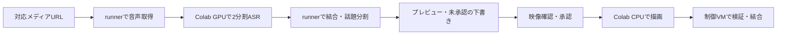

# ClipForge の構成と入口

共通ルールは [AGENTS.md](AGENTS.md)。必要な機能をここで選び、関係するコードと文書だけ読む。通常の作業で過去の調査を一通り読み直す必要はない。

## 処理構成

URL経路はGeminiを呼ばない。音声だけの入力は解析まで。Kickは採用区間の映像を取得する。追加URL経路は形式によって全体転送が必要になる。

ローカル動画の自動選定は、ASR・場面境界・チャットから候補を作り、候補映像・音声・該当ASRを指定Geminiモデルへ送る。返った候補内時刻を元動画の秒へ戻して検査し、FFmpegで描画する。手動選定とcutは生成APIを使わない。時刻指定のcutは `media.cut` で入力前シーク・ストリームコピーを行い、ASR・描画設定・パイプラインの再開処理を通さない。

## コードの入口

表の単独ファイル名は `src/clipforge/`。設定は `models.py` とconfig例、依存は `pyproject.toml` と `uv.lock`。

| 担当 | ファイル |
| --- | --- |
| 投入・状態確認・回収 | `tools/submit_job.py` |
| 承認後の投入・回収・結合 | `tools/submit_audio_stage.py` |
| 入力URL・取得済み音声の検査と取得 | `media_sources.py`・`kick_media.py` |
| 音声取得・2分割の制御 | `tools/acquire_audio_url.py`・`tools/split_asr_job.py`・`asr_split.py` |
| ASR・音量・候補信号、実行資源・モデルキャッシュ | `signals.py`・`hardware.py` |
| 話題・ヒント・下書き | `topics.py`・`topic_hints.py`・`review_draft.py` |
| 段階の処理・再利用・描画 | `audio_first.py`・`worker_audio.py`・`pipeline.py` |
| 共通の承認検査・保存・外部コマンド | `review.py`・`storage.py`・`github_cli.py` |
| 字幕・改行・文末・フォント | `captions.py`・`caption_breaks.py`・`asr_cleanup.py`・`fonts.py` |
| FFmpeg・画面配置・音量と字幕の品質 | `media.py`・`auto_layout.py`・`quality.py`・`landscape.py` |
| Kickチャットの取得・表示・候補密度 | `kick_chat.py` |
| 素材・図表・サムネイル | `assets.py`・`diagrams.py`・`tables.py`・`thumbnail.py` |
| Colab制御・転送・キャッシュ | `tools/colab_actions.py`・`tools/colab_remote_job.py`・`tools/colab_bundle.py`・`tools/colab_cache.py` |
| runの時間・保存ASRの比較 | `tools/inspect_job.py`（`timings` / `compare`） |

手元の段階実行は `python -m clipforge.audio_first`、横動画の確認は `python -m clipforge.landscape`、話題のヒントは `python -m clipforge.topic_hints`。非公開workerが直接呼ぶ `tools/run_audio_stage.py` と `tools/youtube_transport.py` は配備契約の入口として残す。

## worker と成果物

公開リポジトリはコードの保存先。非公開workerのworkflow原本は `deploy/clipforge.yml` と `deploy/audio-stages.yml` 等。実行先は非公開 `ai-model-workers` で、公開側 `.github/workflows/` は検査・ビルドを行う。

入力・設定・実装SHA、各段階と成果物のハッシュを検証して再利用する。ASRは元動画の秒を保持し、字幕・描画で相対時刻へ変換する。クリップは検査後にディレクトリ単位で確定し、元入力は上書きしない。

主な出力はMP4、ASS/SRT、品質値、出典台帳、manifest、request/render receipt。URL経路の納品は `delivery/` にまとまる。`complete` は機械処理の完了で、内容確認・警告0件・公開の完了ではない。

## 文書

| 用途 | 参照先 |
| --- | --- |
| URLの段階・映像承認 | [AUDIO_FIRST.md](docs/AUDIO_FIRST.md) |
| 認証・Colab・2分割ASR | [COLAB.md](docs/COLAB.md) |
| 回収・再開・私有データ | [OPERATIONS.md](docs/OPERATIONS.md) |
| 品質規則・納品前の確認 | [QUALITY_DECISIONS.md](docs/QUALITY_DECISIONS.md) |
| 開発・検証 | [DEVELOPMENT.md](docs/DEVELOPMENT.md) |
| YouTube固有の取得運用 | [YOUTUBE_TRANSPORT.md](docs/YOUTUBE_TRANSPORT.md) |
| ライブラリとライセンス | [THIRD_PARTY.md](docs/THIRD_PARTY.md) |
| 必要時だけ参照する過去の記録 | [HISTORY.md](docs/HISTORY.md) |
