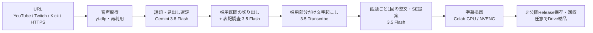

# ClipForge

長い配信から、話題ごとの**横動画（16:9）**と**縦型ショート（9:16）**を作る制作パイプライン。URL を1つ渡すと、話題選定・文字起こし・整文字幕・GPU描画・非公開保存・回収までを一続きで進めます。



| 段 | 処理 | 実行場所 |
| --- | --- | --- |
| 1 | 元音声を取得（保存済みなら再利用） | Actions runner |
| 2 | 音声全体から話題と採用区間を決める | Actions runner → Vertex |
| 3 | 採用音声を切り出し、固有名詞の表記を1回だけ調べる | Actions runner |
| 4 | 採用部分だけを文字起こし（単語時刻・話者分離） | Vertex |
| 5 | 話題ごとに1回、要約せず整文し効果音を提案 | Actions runner → Vertex |
| 6 | 360p 横型（既定）または 720×1280 縦型へ字幕を焼き付け | Colab GPU |
| 7 | 完成動画と工程記録を非公開Releaseへ保存し回収 | 制御側 |

## 最短手順

```bash
make setup                                   # 依存を入れる（制御側は軽量）
make produce URL='https://kick.com/CH/videos/ID' OUT=/private/name
make resume  OUT=/private/name               # 切断後の再接続（新規投入しない）
make collect OUT=/private/name CLIP=1        # 終わった1本だけ先に回収
```

`make` を使わない場合は `uv run --no-sync python tools/produce_with_gemini.py URL --output DIR`。主なオプション：`--clips 3`（本数の目安）、`--render-profile standard|full-hd`（720p/1080p）、`--deliver-drive`（描画後にDriveへ納品）。初回の接続設定は [docs/QUICK_START.md](docs/QUICK_START.md)。

## 自動化

`autopilot` が配信の終了を見張り、Discord のボタン1つで制作を始めます。完成品は YouTube（非公開→承認で予約公開）、X、TikTok 下書きへ送ります。毎日の視聴データは次の話題選定に戻します。他の配信者の素材は承認制、自分のチャンネルは完全自動にできます。登録と設定は [docs/AUTOPILOT.md](docs/AUTOPILOT.md)。

## 設計の考え方

- **段階ごとに保存して再利用。** 同じ素材・依頼文・ルールの応答や完成クリップは再利用し、二重に課金・描画しない。`--resume` は監視と回収だけを行う。
- **目標は目安。** 本数（既定5本・各5〜15分）・文字数・同期・音量・画質は目指す値。未達でも止めず、水増しも再生成もしない。実際の本数を報告する（[仕上げ目標](docs/FINISHING_TARGETS.md)）。
- **監査・strict検査なし。** 完成動画の全デコード、音量の再測定、追加モデルでの査読は行わない。素材の欠落・認証失敗・取り違えだけを実行エラーとする。
- **字幕は要約しない。** 言い淀みと明らかな誤認識だけを整え、意味・口調・語順を残す（[共通編集ルール](src/clipforge/prompts/gemini_editorial_rulebook_ja.md)）。
- **書き出しは NVENC p5/hq＋AQ と BT.709 タグ。** 文字の縁とグラデーションを崩さず、スマホでも色が薄くならない。FFmpeg の定番設定は skill `.claude/skills/ffmpeg-quality/` にまとめている。
- **公開コードと非公開データを分ける。** コードと Actions はこのリポジトリ、動画・音声・字幕・モデル応答は非公開保存庫へ置く。

## 関連リポジトリ

| リポジトリ | 役割 | ClipForge との接続 |
| --- | --- | --- |
| **ClipForge** | 取得・話題選定・文字起こし・整文・描画・保存（本体） | — |
| shorts-only | 縦型ショートの単独制作、配信者プリセット、CapCut ドラフト | `CLIPFORGE_DIR` で本体を呼ぶか単独で動く |
| ClipForge-Delivery | 案件・完成物・費用・納品記録の管理画面 | 本体の出力フォルダをファイルで取り込む |
| Translation | 海外動画の文字起こし・翻訳・字幕付き動画 | 取得部分を同梱して単独で動く |
| 3D- | 図解解説動画の制作 | 単独 |
| discord-digital-delivery | Discord でのデジタル商品の販売・配布（Cloudflare Workers） | 単独 |

shorts-only と Delivery は同じ `CLIPFORGE_DIR`（必要なら `CLIPFORGE_PYTHON`）を使えます。

## 文書

- [最短手順](docs/QUICK_START.md)：初回接続・新規制作・再接続
- [制作と修正](docs/PRODUCTION_AND_REVISION.md)：字幕・見出しの修正、描画の再利用、回収・納品だけの操作
- [縦型ショートと CapCut](docs/TIKTOK_SHORTS.md)
- [音声経路の詳細](docs/GEMINI_AUDIO_REVIEW.md)・[構成](docs/ARCHITECTURE.md)・[開発](docs/DEVELOPMENT.md)
- [INDEX.md](INDEX.md)：コードの地図

旧全編GPU ASRの手順は、過去の成果物を明示的に復旧する場合だけ使います。
