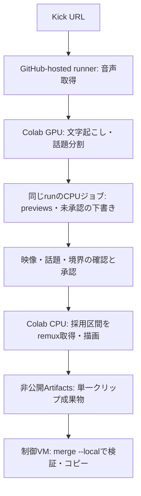
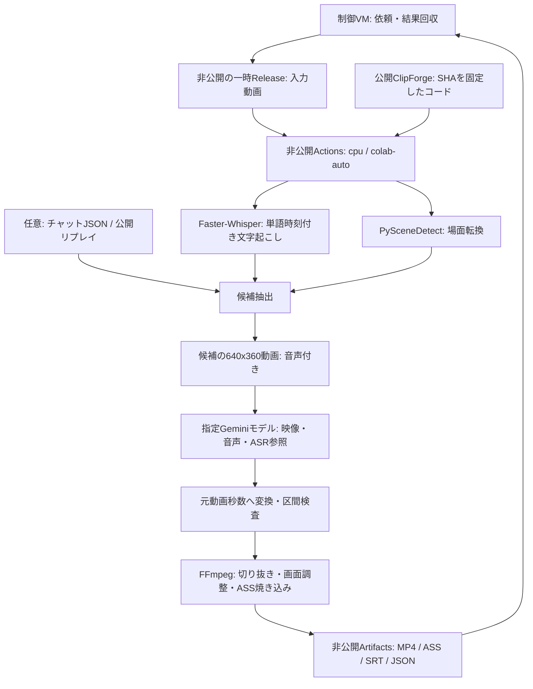

# 構成

## 主な経路：音声先行のKick URL

URL経路はGeminiを呼ばず、全編の高画質映像・場面検出を先に実行しない。段階固有の手順は [AUDIO_FIRST.md](AUDIO_FIRST.md)、回収・再開・結合は [OPERATIONS.md](OPERATIONS.md) を参照。

## ローカル動画：Gemini選定

## ローカル動画の処理の詳細

1. **入力**：ローカルの自己完結した動画1本。既定上限1 GiB・60分、設定可能上限2 GiB・12時間。音声先行URL経路の横用設定は6時間です。ローカル動画入力にHLSやネットワーク参照プレイリストは使わず、元動画は変更しません。
2. **文字起こし**：16kHzモノラル音声を一時抽出。Faster-WhisperをCUDA/float16またはCPU/int8・VAD・単語時刻付きで実行します。音声のない動画では空の文字起こしを使用。
3. **候補抽出**：AdaptiveDetectorの場面転換、発話量、フック語、チャット密度と笑い反応を採点。重複を減らし、時間帯の偏りも抑えます。スコアはヒューリスティックで、面白さの保証ではありません。
4. **映像選定**：候補だけを640x360・5fps・音声付きMP4にし、Gemini Files APIへ送ります。モデルには既定2fpsでの解析を指定。候補のASR文も渡し、1回の生成で構造化JSONを要求します。モデルIDは必須です。
5. **時刻の検査**：モデルは各候補内の0秒始まりで返答。元動画秒数へ戻し、既知の候補ID・動画長・指定尺・区間重複を検査してから描画します。生成が失敗・拒否・不正JSONの場合は停止します。
6. **出力**：FFmpegで、利用可能ならNVENC、なければlibx264でH.264へ再エンコード。描画・フィルタは `encode_threads=0`（利用可能な全コア）が既定で、ASRの `threads=0`（自動）とは別に指定します。画面調整・ASS字幕・音量調整を行います。
7. **字幕**：単語時刻を切り抜き開始からの相対秒数へ変換し、pysubs2でASS/SRTを生成してlibassで描画します。長いASRトークンの分割時刻は文字数比例の概算で、単語境界・認識精度は人による確認が必要です。区切り・改行・文末・横字幕7字/秒の規則は [QUALITY_DECISIONS.md](QUALITY_DECISIONS.md) を正とします。
8. **品質検査**：字幕・フォント・出典・音声・全復号を検査し、`quality.json` に失敗と警告を記録します。strictでは失敗があるクリップの確定を止めます。検査項目・目標値と根拠は [品質検査](QUALITY_DECISIONS.md#5-品質検査) を参照してください。
9. **話題・無音・画像**：発話の間と語彙の変化から話題を区切り、候補を話題ごとに配ります（`topics.py`）。任意で無音を詰め、時刻を出力時間へ変換します（`silence.py`）。画像は手元のファイル、独自図解、Wikimedia Commons／Openverseの検索結果から取り、出典・ライセンスが揃ったものだけを描画します（`assets.py`、`diagrams.py`）。BGMは声の間に下げ、効果音は指定時刻に入れます。

## 再開・記録

- 入力SHA-256、設定、実装ファイルのハッシュが一致するときだけ同じ出力先を再開。
- 各段階のJSONとそのハッシュを記録し、壊れた途中結果を採用しません。
- 元動画の時刻は保持し、字幕・レンダリングの中でだけ切り抜き基準へ変換します。
- クリップは一時ディレクトリへ書き、MP4・字幕・サイズと長さの検査が終わってから確定します。
- 生成済みクリップの上書きや、別の選定結果での黙示的な再利用は行いません。
- Gemini選定結果が保存済みなら再利用し、追加推論は行いません。未完了の推論は自動再試行しません。
- 文字起こしは、入力の SHA-256、音声の長さ・開始位置、Whisperの設定（モデル・リビジョン・言語・スレッド・一括処理）、音声を読む側のコード（`signals.py`・`media.py`）のハッシュから作る鍵で、`transcript_cache` のフォルダに保存します。字幕・描画だけを変えた再実行では、この保存済みの文字起こしを再利用します（認識のやり直しを省く）。
- 成功時は `manifest.json: status=complete`。途中失敗は `failure.json`、描画前は `status=selected`。いずれも人の確認済みとは記録しません。

## 配置

- `src/clipforge/`：CLI、文字起こし、候補抽出、Gemini、字幕、描画。
  - `quality.py`（字幕・音量・出典の検査と `quality.json`）、`topics.py`（話題の区切り）、`silence.py`（無音カット）、`fonts.py`（フォントの確認）、`assets.py`（画像検索と出典台帳）、`tables.py`（Wikipediaの表の検索）、`diagrams.py`（独自図解とSVG）、`thumbnail.py`（サムネイル）。
- `tools/submit_job.py`：標準ライブラリだけで動く制御VM用の依頼・回収ツール。
- `tools/run_request.py`：指定の非公開リポジトリで入力を検査し、処理・削除する入口。
- `deploy/clipforge.yml`：非公開 `ai-model-workers/.github/workflows/clipforge.yml` に配置するワークフロー原本。公開側では実行しません。
- `deploy/audio-stages.yml`：非公開workerの `.github/workflows/clipforge-stages.yml` に配置する後段workflow原本。`tools/submit_audio_stage.py` がpreviews・承認済みrender・mergeを依頼します。
- `uv.lock`：Python依存の固定。チャット取得は `chat` extra。
- 公開側の `.github/workflows/build.yml` はコードの構文検査とwheel作成だけです。

## 実装の到達点

切り抜き、文字起こし・字幕、映像付きGemini選定、非公開Actionsへの依頼・回収を実装。
検証結果は [QUALITY_REVIEW.md](QUALITY_REVIEW.md)、現在有効な決定と未確認事項は [QUALITY_DECISIONS.md](QUALITY_DECISIONS.md) を参照してください。合成検証・実ASR・描画・人による品質確認は別の達成状態として記録します。
初期運用は明示依頼1件ずつ。定期的な動画収集・自動公開は追加していません。

## 音声先行の横動画入口

`tools/kick_audio_first.py` / `clipforge.audio_first` は公開Kick VOD向けの段階式入口。
音声取得だけで停止でき、全編ASR・語彙/間による話題割り振り・候補映像の確認・採用区間の高画質取得を分離する。
全編の映像場面検出は呼び出さない。全編ASRを各採用区間へ時刻変換して共有し、区間ごとの認識を繰り返さない。
既存 `clipforge run/analyze` のローカル動画経路とは別。運用と制限は [AUDIO_FIRST.md](AUDIO_FIRST.md)。
## Colabの制御とデータ

`colab-auto` はActionsのCPU制御ジョブから公式SDKで専用ランタイムを割り当て、処理・回収後に解放します。URL経路はGPUでASR・話題分割、承認後はCPUで描画し、ローカル動画経路はGemini選定と描画まで含みます。公開キャッシュは既定off。認証・起動・転送・キャッシュ・解放の詳細は [COLAB.md](COLAB.md) を参照してください。
