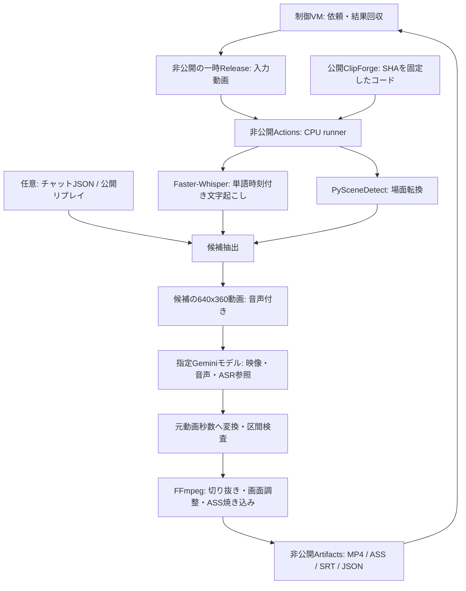

# 構成

## 処理の詳細

1. **入力**：ローカルの自己完結した動画1本。初期上限1GiB・60分、設定上限2GiB・120分。HLSやネットワーク参照プレイリストは入力にしません。元動画は変更しません。
2. **文字起こし**：16kHzモノラル音声を一時抽出。Faster-WhisperをCPU/int8・VAD・単語時刻付きで実行します。音声のない動画では空の文字起こしを使用。
3. **候補抽出**：AdaptiveDetectorの場面転換、発話量、フック語、チャット密度と笑い反応を採点。重複を減らし、時間帯の偏りも抑えます。スコアはヒューリスティックで、面白さの保証ではありません。
4. **映像選定**：候補だけを640x360・5fps・音声付きMP4にし、Gemini Files APIへ送ります。モデルには既定2fpsでの解析を指定。候補のASR文も渡し、1回の生成で構造化JSONを要求します。モデルIDは必須です。
5. **時刻の検査**：モデルは各候補内の0秒始まりで返答。元動画秒数へ戻し、既知の候補ID・動画長・指定尺・区間重複を検査してから描画します。生成が失敗・拒否・不正JSONの場合は停止します。
6. **出力**：FFmpeg CPU/H.264で再エンコード。`fit` は全画面を残して余白を追加、`center-crop` は明示時だけ中央クロップ。9:16 / 16:9 / 1:1、720 / 1080px高を選べます。音声があれば音量を調整します。
7. **字幕**：単語時刻を切り抜き開始からの相対秒数へ変換。pysubs2でASSを生成しlibassで描画、SRTも保存。長いASRトークンを分割した箇所の時刻は文字数比例の概算です。単語境界・音声認識精度は人による確認が必要です。1秒あたり10文字を超える字幕は、次の字幕までの無音へ表示を延ばします（開始時刻は変えず、重なりも作りません）。字幕の区切りと改行は、句の境界・空白や句読点・閉じ括弧の後を優先し、次に助詞の前（漢字の後は「は・が・を・に・で・と・の・へ・も」だけ）、かなから漢字・カタカナ・英数字への変わり目、カタカナ・英数字・漢字の変わり目を使い、語の途中では区切りません（語が1行より長い場合だけ例外）。行頭に句読点・閉じ括弧・小書きのかな・長音を置きません。文末（形態素解析で、です・ます・だ・た、終助詞の ね・よ・か・な など。後に助詞・助動詞が続く場合は文が続くとみなす）で、その字幕が1秒以上続いていれば字幕を区切ります（文字起こしには句読点がほとんど出ないため）。1秒未満の字幕は、間を空けずに隣と結合でき、2行4秒の上限に収まる場合に結合します。英字の用語（`ai`・`agi`・`asi`、`chatgpt`・`openai`・`gpu`・`api` など）は通常の綴りに直します。`LM Studio` や `Hugging Face` のように2語で書かれた用語は、時刻を保ったまま1つの字幕単位にまとめます。
8. **品質検査**：描画後、字幕の重なり・3行以上の字幕・ASSとSRTの内容の不一致・フォントにない文字・出典とライセンスの欠落を確認し、映像を最後まで復号して、音声のサンプルレート（48 kHz）とEBU R128の統合ラウドネス・真ピークを測ります。結果は `quality.json` に記録します。失敗は `quality_gate=strict` のときだけクリップの確定を止め、警告（読み速度15文字超、1秒未満・4秒超の字幕、語の途中での改行、音量・真ピークの目標外）は常に記録します。
9. **話題・無音・画像**：発話の間と語彙の変化から話題を区切り、候補を話題ごとに配ります（`topics.py`）。任意で無音を詰め、時刻を出力時間へ変換します（`silence.py`）。画像は手元のファイル、独自図解、Wikimedia Commons／Openverseの検索結果から取り、出典・ライセンスが揃ったものだけを描画します（`assets.py`、`diagrams.py`）。BGMは声の間に下げ、効果音は指定時刻に入れます。

## 再開・記録

- 入力SHA-256、設定、実装ファイルのハッシュが一致するときだけ同じ出力先を再開。
- 各段階のJSONとそのハッシュを記録し、壊れた途中結果を採用しません。
- 元動画の時刻は保持し、字幕・レンダリングの中でだけ切り抜き基準へ変換します。
- クリップは一時ディレクトリへ書き、MP4・字幕・サイズと長さの検査が終わってから確定します。
- 生成済みクリップの上書きや、別の選定結果での黙示的な再利用は行いません。
- Gemini選定結果が保存済みなら再利用し、追加推論は行いません。未完了の推論は自動再試行しません。
- 文字起こしは、入力の SHA-256、音声の長さ・開始位置、Whisperの設定（モデル・リビジョン・言語・スレッド・一括処理）、音声を読む側のコード（`signals.py`・`media.py`）のハッシュから作る鍵で、`transcript_cache` のフォルダに保存します。字幕・描画だけを変えた再実行では、この保存済みの文字起こしを再利用します（認識のやり直しを省く）。
- 成功時は `manifest.json: status=complete`。途中失敗は `failure.json`、描画前は `status=selected`。いずれも人の確認済みとは記録しません。

## 配置

- `src/clipforge/`：CLI、文字起こし、候補抽出、Gemini、字幕、描画。
  - `quality.py`（字幕・音量・出典の検査と `quality.json`）、`topics.py`（話題の区切り）、`silence.py`（無音カット）、`fonts.py`（フォントの確認）、`assets.py`（画像検索と出典台帳）、`tables.py`（Wikipediaの表の検索）、`diagrams.py`（独自図解とSVG）、`thumbnail.py`（サムネイル）。
- `tools/submit_job.py`：標準ライブラリだけで動く制御VM用の依頼・回収ツール。
- `tools/run_request.py`：指定の非公開リポジトリで入力を検査し、処理・削除する入口。
- `deploy/clipforge.yml`：非公開 `ai-model-workers/.github/workflows/clipforge.yml` に配置するワークフロー原本。公開側では実行しません。
- `uv.lock`：Python依存の固定。チャット取得は `chat` extra。
- 公開側の `.github/workflows/build.yml` はコードの構文検査とwheel作成だけです。

## 実装の到達点

切り抜き、文字起こし・字幕、映像付きGemini選定、非公開Actionsへの依頼・回収を実装。
CIと同じ条件のローカル実行で、単体テスト（カバレッジ96%）、合成動画による統合テスト、音声認識テストが通ることを確認しています。字幕の読み速度・品質ゲート・映像のフェードは `docs/QUALITY_REVIEW.md` の確認結果を参照してください。利用者の実動画での画質・字幕品質の評価、Geminiのモデル利用枠の確認は未実施です。
初期運用は明示依頼1件ずつ。定期的な動画収集・自動公開は追加していません。
