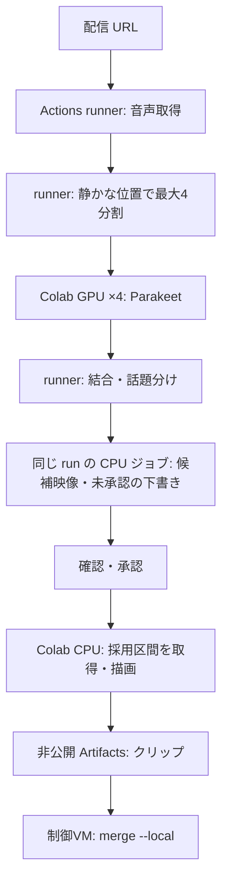

# 構成

## 配置

- `src/clipforge/`
  - 取得：`media_sources.py`（経路の振り分けと yt-dlp）・`kick_media.py`（Kick の HLS）・`youtube_transport.py`・`youtube_auth.py`（YouTube の WARP と Cookie）
  - 文字起こし：`asr.py`（Colab 側の Parakeet）・`asr_split.py`（runner 側の分割と結合）
  - 段階：`audio_first.py`（話題の割り当て・プレビュー・描画）・`worker_audio.py`（非公開 worker での段階の実行と結合）・`audio_inputs.py`（検証済み音声の再利用）
  - 話題：`topics.py`・`topic_hints.py`・`review_draft.py`・`chat_activity.py`・`audio_volume.py`
  - 描画：`pipeline.py`（1クリップの描画）・`media.py`（ffmpeg）・`captions.py`・`caption_breaks.py`・`caption_sentences.py`・`asr_cleanup.py`・`auto_layout.py`・`kick_chat.py`・`fonts.py`・`quality.py`・`landscape.py`
  - 重ね絵：`assets.py`・`diagrams.py`・`tables.py`・`thumbnail.py`・`silence.py`
  - 共通：`models.py`（設定と時刻の型）・`storage.py`（保存・ハッシュ）・`hardware.py`・`github_cli.py`
- `tools/`
  - 制御VM：`submit_job.py`（解析の投入・回収）・`submit_audio_stage.py`（描画の投入・結合）・`run_timings.py`・`check_worker_workflows.py`・`configure_colab_oauth.py`
  - runner：`acquire_audio_url.py`・`split_asr_job.py`・`run_audio_stage.py`・`colab_actions.py`（Colab の割り当てと解放）
  - Colab：`colab_remote_job.py`・`colab_bundle.py`（結果の受け渡し）・`colab_setup.sh`（描画用の環境）
- `deploy/`：非公開 worker に置く workflow の原本（`clipforge.yml`・`audio-stages.yml`・`colab-usage.yml`）。公開側では実行しない。

## 再開と記録

- 各段階は入力・設定・コードのハッシュから鍵を作り、同じ鍵の結果だけを再利用する。壊れた途中結果は使わない。
- 元配信の時刻は保ち、字幕と描画の中でだけクリップ基準へ変える。
- クリップは一時ディレクトリに書き、MP4・字幕・長さの検査が済んでから確定する。
- 成功時は `manifest.json` に状態を書く。人の確認済みとは記録しない。
