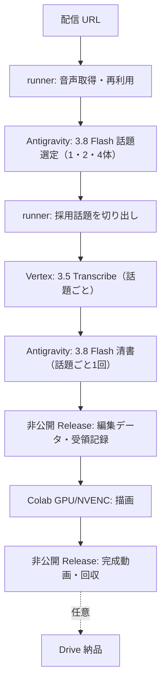

# 構成（現行）

## 配置

- `src/clipforge/`
  - 取得: `media_sources.py`（経路の振り分けと yt-dlp）・`kick_media.py`（Kick）・`youtube_transport.py`・`youtube_auth.py`
  - 音声理解と文字起こし: `audio_understanding.py`（話題選定と清書の工程本体）・`antigravity_client.py`（Antigravity SDK）・`gemini_audio_editor.py`（音声の切り出しと符号化）・`transcribe_pipeline.py`（Transcribe）・`transcribe_trial.py`（試行）
  - 段階と保存: `worker_audio.py`（worker での段階の実行）・`audio_inputs.py`（検証済み音声の再利用）・`storage.py`（保存とハッシュ）・`models.py`（設定と時刻の型）・`editorial_revision.py`（明示修正パッチ）・`release_transfer.py`（Release の回収）
  - 描画: `pipeline.py`（1 クリップ）・`media.py`（ffmpeg）・`captions.py`・`caption_breaks.py`・`caption_sentences.py`・`caption_emotions.py`（演出のスタイル）・`auto_layout.py`・`kick_chat.py`・`fonts.py`・`landscape.py`・`streaming_render.py`・`gpu_slots.py`（同時 5 枠）・`hardware.py`（NVENC）・`visual_reference.py`（参考画像）・`sound_effects.py`（効果音の合成。現行の清書では指示なし）
  - 旧経路（復旧用）: `asr.py`・`asr_split.py`・`asr_cleanup.py`・`audio_first.py`・`topics.py`
  - 共通: `github_cli.py`・`connections.py`
- `tools/`
  - 制作の入口: `produce_with_gemini.py`（通常入口）・`collect_production_clip.py`（完成クリップの回収）
  - runner と Colab: `acquire_audio_url.py`・`run_audio_stage.py`・`colab_actions.py`（割り当てと解放）・`colab_remote_job.py`・`colab_bundle.py`・`colab_setup.sh`
  - 並列描画: `dispatch_parallel_render.py`（clip 別の Run と merge Run）
  - 接続確認: `check_github_api.sh`・`check_antigravity_vertex.py`・`configure_colab_oauth.py`
  - 依頼された場合だけ: `opencode_harness.py`
  - 旧の投入と回収（復旧用）: `submit_job.py`・`submit_audio_stage.py`・`split_asr_job.py`・`selected_gpu_asr.py`
- `deploy/`: 非公開 worker に置く workflow の原本（`clipforge.yml`・`audio-stages.yml`・`colab-usage.yml`・`opencode-vertex.yml`）。公開側の定義と揃える。

## 再開と記録

- 各段階は入力・設定・コードの指紋から鍵を作り、同じ鍵の結果だけを再利用する。壊れた途中結果は使わない。
- 元配信の時刻は保ち、字幕と描画の中でだけクリップ基準へ変える。
- クリップは一時ディレクトリに書き、書き出しが済んでから確定する。
- 成功時は `manifest.json` に状態を書く。人の確認済みとは記録しない。
