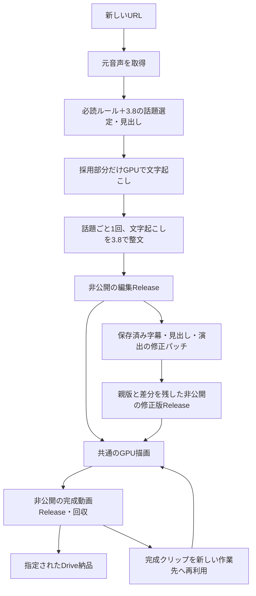

> 字幕・音・余白・解像度・参考画像の目標と未達時の扱いは [FINISHING_TARGETS.md](FINISHING_TARGETS.md)。すべて目安で、品質ゲートではありません。

# 通常制作・修正・再開の共通経路

接続・新規制作・再接続は [最短手順](QUICK_START.md) を参照。新規制作も修正も、同じ `final-selection.json` / `selected-transcripts.json` を描画へ渡す。モデルへ戻る必要がない修正は、保存済み編集データの別版として記録して直接描画する。モデル呼び出し・描画・保存・納品を混同しない。



## 入口と選び方

接続済みなら `python tools/produce_with_gemini.py URL --output NEW_PRIVATE_DIR` で通常制作を開始できる。`--source-ref` 省略時は既定の専用実行ブランチのSHAを一度だけ取得して固定し、production-stateへ記録する。VertexはActionsのOIDC、Colabは登録済み専用資格情報をそのまま使う。設定確認のためのテスト・監査・試験的なモデル要求やGPU確保は挟まない。

YouTubeの新規音声取得とGPU上の採用映像取得は、同じ既存の `YOUTUBE_COOKIES_B64` Secretを利用する。値をログ・公開入力・成果物へ出さない。未設定時にログインなしで取得できることは保証しない。YouTubeがログイン確認を要求した場合は認証接続の問題として記録し、別アカウント・別経路への切り替えや自動再投入は行わない。

### 待機と既存Runへの再接続

通常の音声理解・Colab描画はrequest IDごとの待ち行列を使い、無関係な制作依頼との共通ロックを避ける。同じrequestの排他は保持し、進行中Runを自動キャンセルしない。GitHub内部のジョブ生成時間やrunner供給時間を保証するものではない。

状態取得APIの一時失敗は監視の問題として記録し、最後に得た制作状態を残して読み取りだけを再試行する。モデル要求・workflow dispatchは再送しない。初期の汎用タイトルから別Runを推測せず、request ID付きタイトルを待つ。監視状態・待機時間はproduction-stateと約60秒ごとの表示へ残す。監視期限切れは `monitoring_paused` とし、遠隔の制作失敗と区別する。

監視が途切れた場合は、同じ出力先を指定する。URL・Run IDは保存状態から復元できる。

```sh
python tools/produce_with_gemini.py --resume --output "$EXISTING_PRIVATE_OUTPUT"
```

この入口は保存済みrequest IDとRunを照合し、既存制作の監視と完成物回収を行う。新しいモデル要求・制作は投入しない。元の依頼にDrive納品が含まれる場合は未投入の納品だけを開始し、投入済み納品は同じRunを監視する。参考JPEG等の単体assetが追加されていても、回収対象は `result.zip` と `transfer.json` の2件だけとし、画像不足を理由に動画を再制作しない。

| やりたいこと | 入口 | 戻らない工程 |
|---|---|---|
| 新しい配信から制作 | `tools/produce_with_gemini.py URL --source-ref SHA --output PRIVATE_DIR` | 全編ASR・全文GPU文字起こしへ戻らない |
| 字幕本文・推定時刻・見出し・話者色・感情・効果音を修正 | 同じCLIに `--render-only --editorial-release PARENT --revision-file PRIVATE_PATCH` | Gemini・音声理解・字幕再生成へ戻らない |
| 編集済みデータから描画だけ行う | `--render-only --editorial-release TAG` | モデルへ戻らない |
| 前回完成クリップを使って変更分だけ描画 | 上記に `--reuse-render --previous-run RUN --previous-request REQUEST` | 一致する完成クリップの再エンコードを省く |
| まだ投入していないモデル工程だけ進める | `--editorial-release TAG --continue-missing` | 完了済み応答は同じ依頼文・ルールハッシュで再利用。不明な送信を自動再送しない |
| 保存済み完成動画の回収だけ | `python -m clipforge.release_transfer download RUN clipforge-result-REQUEST PRIVATE_DIR` | モデル・描画へ戻らない |
| Driveへの納品だけ | `clipforge-drive-delivery.yml` のupload-release | モデル・描画へ戻らない |

`SHA` は使用するコードの40桁コミット。実行ブランチは既定の `main` を使い、指定された `fix/pr18-verified-transfer` も選べる。`--previous-run` / `--previous-request` は既存の `--analysis-run` / `--analysis-request` の別名。render-onlyにはこのID対が必要。`--reuse-render`では必ず「直前の完成動画Release」のRun/requestを渡す。編集ReleaseのRunを元音声/完成動画ReleaseのIDとして流用しない。

## 明示的な修正パッチ

非公開の作業先にJSONを置く。`clip` と `segment` は1始まり。字幕の番号は保存済み `selected-transcripts.json` の順番を使う。指定しない項目は保持する。別素材への差し替え、クリップ追加・並べ替え、元配信区間の再選定は、この字幕修正パッチでは扱わない。

```json
{
  "reason": "見出しを具体化し、字幕の表記と感情演出を修正",
  "clips": [{
    "clip": 1,
    "title": "楽しみにしていた店が…大雨で入れず",
    "segments": [{
      "segment": 3,
      "text": "たぶん来週、雨が降らなければ行くと思う",
      "start": 12.4,
      "end": 16.8,
      "emotion": "curiosity",
      "emotion_level": 1,
      "emotion_confidence": 1.0
    }],
    "sound_effects": []
  }]
}
```

本文・時刻・感情は必要な項目だけ指定できる。話者色を直す場合はクリップ行に `speaker_turns`（start/end/speaker_id/confidence）を指定し、そのクリップの注釈を置き換える。不確かな話者は通常色に戻す。`sound_effects` は指定した場合にそのクリップの指示を置き換え、空配列なら効果音を外す。時刻は切り抜き先頭からの秒数で、元配信全体の時刻ではない。入力同一性や存在しない番号への修正は実行エラーとして報告する。意味・数字・断定の度合いを変える修正を勝手に加えない。

本文・開始・終了を実際に変更した字幕では、その字幕の古い `words` だけを外し、修正後の本文と時刻を描画へ渡す。感情だけの変更や未変更の字幕では単語データを保持する。親版は変更しない。

通常CLIの統合例:

```sh
python tools/produce_with_gemini.py "$SOURCE_URL" \
  --source-ref "$CODE_SHA" --output "$NEW_PRIVATE_OUTPUT" \
  --render-only --editorial-release "$PARENT_EDITORIAL_TAG" \
  --revision-file "$PRIVATE_PATCH" \
  --reuse-render --previous-run "$LAST_RENDER_RUN" \
  --previous-request "$LAST_RENDER_REQUEST"
```

この入口は保存済み3ファイルを取得し、パッチを新しい作業先へ適用し、素材URLを照合して、修正版を非公開ai-model-workersへ一度保存した後、同じ描画workflowを投入する。入力JSONや字幕を公開workflow入力へ直接渡さず、非公開Releaseのタグを渡す。別アカウント・別モデルへ切り替えない。

準備だけなら、`python -m clipforge.editorial_revision --parent-release TAG --patch PRIVATE_PATCH --output NEW_PRIVATE_DIR`。この時点でモデル要求とRelease書き込みはゼロ。`--publish` を明示すると非公開Releaseへ保存する。統合CLIを使った場合は準備・保存・描画をまとめて進める。

## 版・再利用と記録

修正版タグは `clipforge-kick-editorial-revision-32桁ID`。親Release、親3ファイルのSHA-256、パッチSHA-256、変更クリップ番号、理由、修正によるモデル要求0件を記録する。元のモデル応答と使用ルール記録は書き換えず、手動修正と区別する。修正版はrender-onlyへ進め、continue-missingでGeminiへ戻さない。

新しい描画では各クリップの素材URL・選定区間/見出し/話者/効果音・字幕本文/時刻/感情・描画設定・描画レシピ版から個別キーを作る。修正版全体のIDや別クリップの変更を、このキーに混ぜない。完成クリップのキーが一致すれば保存済みファイルを再利用し、違うクリップだけ新しい作業先で描画する。`manifest.json` に再利用本数・新しく描画した本数・修正版情報を記録する。

過去の動画にこの個別キーがない場合や、字幕配置/フォント等の共通設定・描画レシピ版が変わる場合は、そのクリップを再利用したとは報告しない。新しい描画が必要になる。今回の実装適用だけを理由に過去動画を作り直さない。再利用時の保存記録・ファイル同一性の照合は素材取り違え防止であり、字幕品質監査や完成動画のデコード検査は行わない。

`production-state.json` は投入前のrequest IDと工程状態を残す。`revision-state.json` はprepared/publishing_or_unknown/publishedを区別する。送信・公開の成否が不明なとき、同じコマンドを新しい出力先で反復して水増ししない。記録されたRun/タグから再開先を判断する。完成動画があればまず回収し、納品だけの失敗で制作へ戻らない。

## 仕上げと描画プロファイル

新規選定時に切り出し余白を一度だけ加え、採用音声のGPU文字起こし時刻を使う。採用話題ごと1回で字幕を作るため60秒境界の結合処理は不要。修正・render-onlyでは保存済みの時刻を使い、これらを再適用しない。素材は最大360p、標準の文字キャンバスは720p。`--render-profile preview` は360p、`standard` は720p、`full-hd` は1080pを選ぶ。モデルへ戻らずrender-onlyでも変更できるが、解像度が変わるクリップは新しい描画が必要になる。

新規描画の `contact-sheet.jpg` は最大3場面の参考画像で、品質判定ではない。非公開zip内に保存し、可能なら完成Releaseへクリップ名付きの単体JPEGも追加する。画像が作れない場合も動画の保存を続ける。画像を見て直したい箇所があれば、同じ明示パッチへ進む。画像を作ったことだけで目視確認済みとは報告しない。

再利用時に参考JPEGだけが欠けても、動画・字幕と入力キーが一致すれば再利用を続け、参考画像は `not_available_on_reuse` と記録する。画像を補うための再描画はしない。保持されているファイルのハッシュ不一致は、品質目標とは別のファイル同一性の問題として扱う。

## 演出の基準

原音から明確な感情の変化が分かる箇所だけ、通常0・控えめ1・強め2。フォント・サイズ・色は固定プリセットで描画側が決める。話者が確かな場合は話者の文字色を維持し、感情は暗い縁の色と字体・サイズで表す。しんみりは明朝系、他はゴシック系。明朝が使えなくても通常フォントで続行する。最大サイズ増加8%を含めた文字幅を使って改行する。演出数・見出し文字数の不足で止めない。

必読の[編集ルールブック](../src/clipforge/prompts/gemini_editorial_rulebook_ja.md)が表現の基準。無理な煽り、深刻な話題の派手な演出、無根拠な感情判定、全文ASR、追加監査モデル・品質検査・再測定は加えない。

今回の登録ではテスト・モデル呼び出し・制作・映像検査を実行していない。実装と通常制作での実績は分けて報告する。
